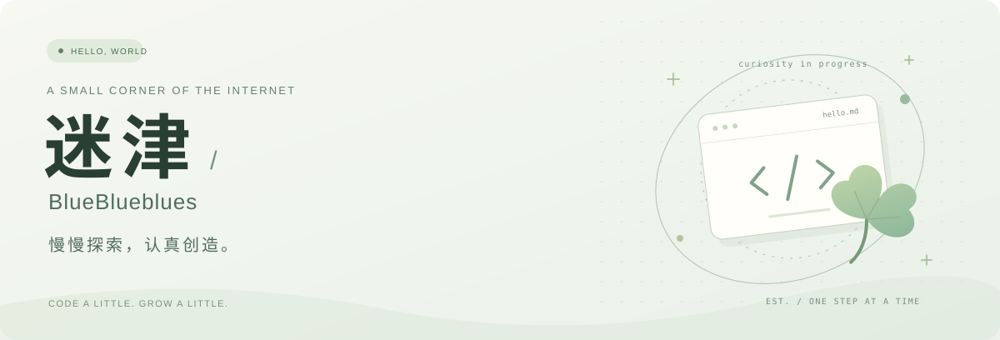

  

  <a href="https://github.com/BlueBlueblues?tab=repositories">我的代码</a> ·
  <a href="https://github.com/BlueBlueblues?tab=stars">灵感收藏</a> ·
  <a href="mailto:libuyu0708@gmail.com">打个招呼</a>

 

### 你好，我是迷津 🍃

把想法写成代码，把过程留在这里。

这里是我的一小块数字花园，收集代码、练习，还有偶然冒出来的小想法。希望每一次小小的尝试，都能让想做的事更近一点。

 

### 在这里，慢慢生长

| 探索 / Explore | 记录 / Document | 创造 / Make |
| :--- | :--- | :--- |
| 给好奇心一点空间。 | 给走过的路留个脚印。 | 让一个小想法发生。 |

 

> 不急着抵达，沿途也有好风景。

 

  Thanks for stopping by. Have a lovely day. ☘️

